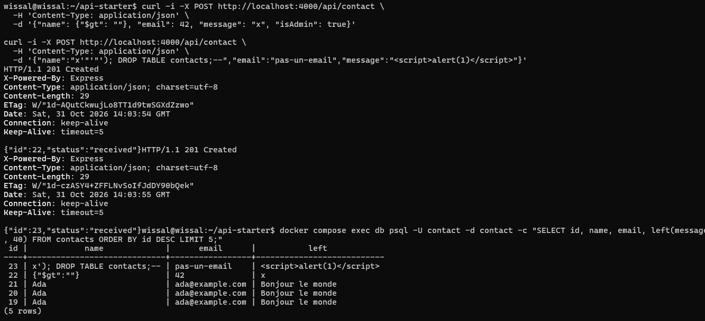
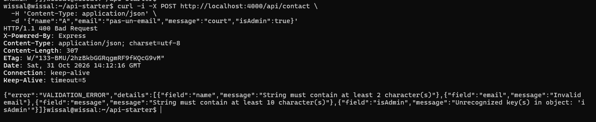
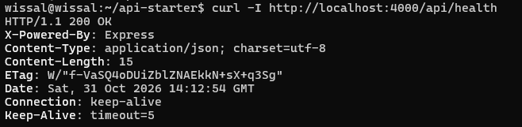
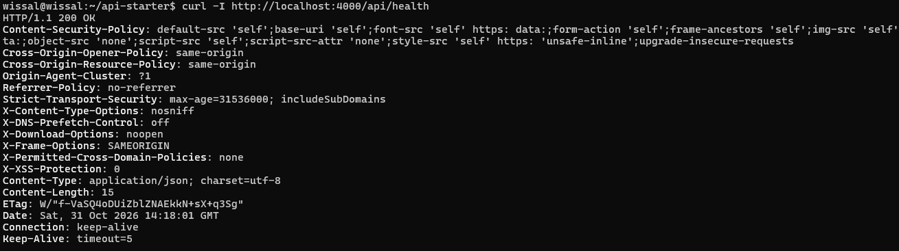
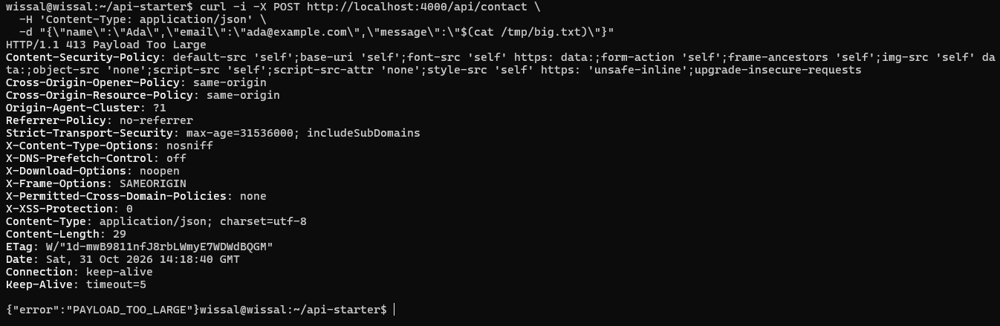
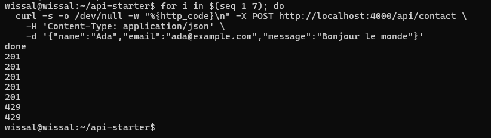
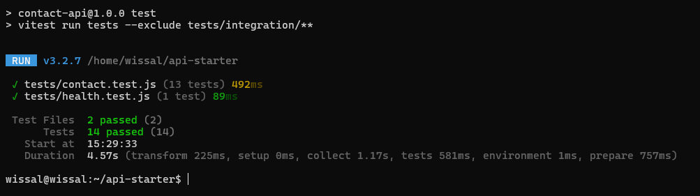
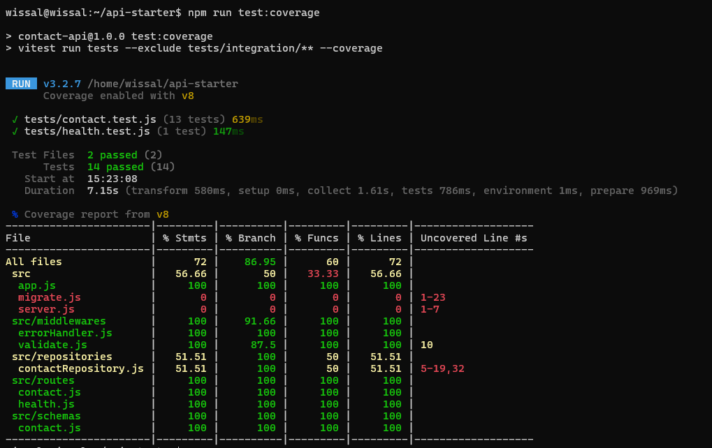
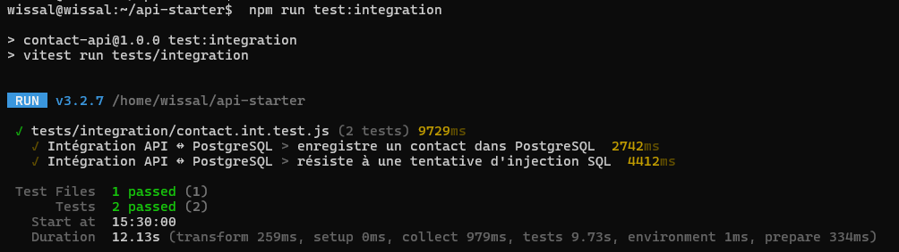

# TP8 : API Express sécurisée et testée

API de formulaire de contact (`POST /api/contact`) rendue robuste avec **Zod**, **Helmet**, **express-rate-limit**, puis prouvée par des tests **Vitest + Supertest** et un test d'intégration contre **PostgreSQL** (Docker Compose).

## Sommaire
1. [Lancer le projet](#1-lancer-le-projet)
2. [Partie 1 : OWASP API Security Top 10](#2-partie-1--owasp-api-security-top-10)
3. [Partie 2 : Validation et gestion des erreurs](#3-partie-2--validation-et-gestion-des-erreurs)
4. [Partie 3 : Durcissement HTTP](#4-partie-3--durcissement-http)
5. [Partie 4 : Tests de routes et couverture](#5-partie-4--tests-de-routes-et-couverture)
6. [Partie 5 : PostgreSQL, migrations, intégration](#6-partie-5--postgresql-migrations-et-intégration)
7. [Bilan](#7-bilan)

## 1. Lancer le projet

```bash
npm install
cp .env.example .env            # puis changer le mot de passe
set -a; . ./.env; set +a
docker compose up -d --wait
npm run migrate
npm start                       # API sur http://localhost:4000
```

| Commande | Rôle |
|---|---|
| `npm test` | Tests unitaires et de routes (repository en mémoire) |
| `npm run test:coverage` | Couverture de code |
| `npm run test:integration` | Test d'intégration contre PostgreSQL |
| `npm run migrate` | Applique les migrations SQL (idempotent) |

## 2. Partie 1 : OWASP API Security Top 10

| Risque OWASP | Concerne notre API ? | Mesure dans ce TP |
|---|---|---|
| API1 Broken Object Level Authorization | Non pour l'instant : aucune ressource accédée par identifiant (cela changerait avec un `GET /api/contact/:id`) | n/a |
| API2 Broken Authentication | Non : endpoint public, sans authentification. Serait indispensable pour une route de liste | n/a (hors périmètre) |
| API3 Broken Object Property Level Authorization | Oui : un client peut envoyer des champs en trop (`isAdmin`, `id`…) | `.strict()` refuse les champs en trop (mass assignment) |
| API4 Unrestricted Resource Consumption | Oui : corps volumineux, rafales de requêtes | Rate limiting, taille max du corps (10 ko) |
| API5 Broken Function Level Authorization | Non : pas de rôles ni de fonctions privilégiées | n/a |
| API6 Unrestricted Access to Sensitive Business Flows | Oui : spam du formulaire par automatisation | Rate limiting sur `/api/contact` |
| API7 Server Side Request Forgery | Non : l'API n'appelle aucune URL fournie par l'utilisateur | n/a |
| API8 Security Misconfiguration | Oui : stack trace exposée, `X-Powered-By`, aucun header de sécurité | Helmet, erreurs génériques, `x-powered-by` désactivé |
| API9 Improper Inventory Management | Faible : une seule version, peu de routes | Route 404 JSON, rien d'inutile exposé |
| API10 Unsafe Consumption of APIs | Non : aucune API tierce consommée | n/a |

### Trois attaques que la version de départ laissait passer

**1. Fuite d'information (API8).** Un JSON tronqué provoquait une `500` avec la stack trace complète : chemin `/home/wissal/api-starter/...`, noms de fichiers, bibliothèques internes, ainsi que le header `X-Powered-By: Express`. Une panne de base révélait aussi l'adresse et le port de PostgreSQL (`ECONNREFUSED 127.0.0.1:5432`).

**2. Entrées non validées (API3).** Types inattendus (`name` objet, `email` nombre), faux email, champ en trop (`isAdmin`), `<script>` et chaîne d'injection SQL étaient acceptés (`201`) et stockés tels quels. L'injection SQL, elle, échouait : la table `contacts` existait toujours, grâce aux requêtes paramétrées.



**3. Pas de limite de débit (API4 / API6).** 20 requêtes d'affilée passaient toutes (les identifiants 1 à 21 en base le confirment), sans aucun `429`.

## 3. Partie 2 : Validation et gestion des erreurs

- `src/schemas/contact.js` : `name` (trim, 2 à 100), `email` (format email, ≤ 254), `message` (10 à 2000), `.strict()`.
- `src/middlewares/validate.js` : `safeParse`, réponse `400 VALIDATION_ERROR` avec `details` (`field` + `message`), et `req.body` remplacé par les seules données validées.
- `src/middlewares/errorHandler.js` : `INVALID_JSON` (400), `PAYLOAD_TOO_LARGE` (413), `INTERNAL_ERROR` (500). La stack est journalisée côté serveur, jamais renvoyée au client.
- `src/app.js` : route 404 JSON `{"error":"NOT_FOUND"}` avant le middleware d'erreur.

Requête invalide : les quatre problèmes (`name`, `email`, `message`, champ en trop `isAdmin`) sont détaillés.



## 4. Partie 3 : Durcissement HTTP

- `app.disable("x-powered-by")` puis `app.use(helmet())`.
- `express.json({ limit: "10kb" })`.
- `express-rate-limit` uniquement sur `/api/contact` : 5 requêtes par minute et par IP, headers `RateLimit-*` standard, corps `{"error":"TOO_MANY_REQUESTS"}`.
- Derrière un reverse proxy, ajouter `app.set("trust proxy", 1)`.

### Headers avant / après Helmet

Avant : `X-Powered-By: Express` et aucun header de sécurité.



Après : `X-Powered-By` supprimé, `Content-Security-Policy`, `Strict-Transport-Security`, `X-Content-Type-Options: nosniff`, `X-Frame-Options`, etc.



### Corps trop volumineux

Un corps de 20 ko est refusé en `413 PAYLOAD_TOO_LARGE`. Les headers Helmet sont présents aussi sur cette réponse d'erreur.



### Rate limiting

Sur 7 requêtes : cinq `201`, puis deux `429`.



## 5. Partie 4 : Tests de routes et couverture

`tests/contact.test.js` (Vitest + Supertest, repository en mémoire) couvre : message valide, email invalide, champ manquant, champ supplémentaire, types inattendus, JSON mal formé, corps > 10 ko, injection SQL stockée comme simple donnée, route 404, erreur 500 sans fuite (ni stack ni message d'origine, mais journalisée), headers Helmet, absence de `x-powered-by` et `429` après 5 requêtes.

Les requêtes refusées sont aussi vérifiées côté repository : un `400` n'écrit rien (`repo.items` reste vide).

**Résultat : 14 tests passés, aucun `todo`.**



### Couverture

Les fichiers de sécurité (`app.js`, `validate.js`, `errorHandler.js`, routes, schéma) sont à 100 % de lignes. `contactRepository.js` (51,51 %), `server.js` et `migrate.js` (0 %) sont exercés par l'intégration ou sont des scripts de démarrage. Total : 72 %.



## 6. Partie 5 : PostgreSQL, migrations et intégration

- `migrations/001_create_contacts.sql` crée la table, `migrations/002_add_contacts_email_index.sql` ajoute l'index `idx_contacts_email`.
- `npm run migrate` est idempotent : la première exécution affiche `migration appliquée : 002_add_contacts_email_index.sql`, la seconde n'affiche rien.
- Vérification : `\d contacts` liste bien `idx_contacts_email btree (email)`.
- `tests/integration/contact.int.test.js` envoie de vraies requêtes, puis contrôle directement en SQL que le contact est enregistré, que la table existe toujours après une tentative d'injection et que la valeur est stockée telle quelle. Il supprime ses propres lignes à la fin.

**Résultat : 2 tests d'intégration passés.**



Test manuel avec `curl` : requête valide `201`, requête invalide `400 VALIDATION_ERROR`, injection SQL `201` (table intacte, valeur stockée comme donnée).

## 7. Bilan

| Menace | Avant | Après |
|---|---|---|
| JSON cassé | `500` + stack trace | `400 INVALID_JSON` |
| Données invalides / champs en trop | Acceptés et stockés | `400 VALIDATION_ERROR` détaillé |
| Corps énorme | Accepté | `413 PAYLOAD_TOO_LARGE` |
| Rafale de requêtes | Illimitée | `429` après 5 requêtes par minute |
| Headers | `X-Powered-By`, aucune protection | Helmet, `x-powered-by` supprimé |
| Injection SQL | Neutralisée (requêtes paramétrées) | Neutralisée et testée automatiquement |

Le défi (workflow GitHub Actions et route `GET /api/contact` paginée) n'a pas été réalisé.
